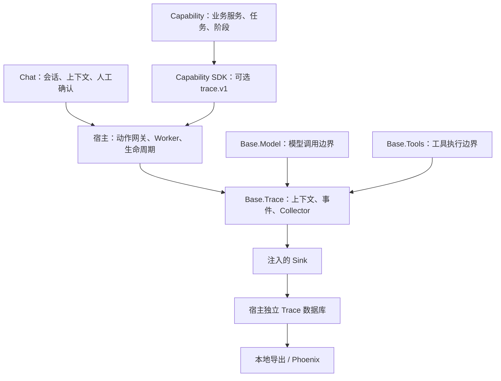

# Deepfield Base.Trace 设计文档

版本：0.2 · 更新日期：2026-11-05

Base.Trace 为 Chat、工具执行和 Capability 提供统一的执行关联与诊断记录。当前提供本地采集、跨 Worker 传递、独立存储、只读查询，以及本地 Phoenix 可视化导出。Capability 使用可选的 `trace.v1` 宿主服务。

## 1. 职责与依赖

Trace 回答一次任务经过哪些调用、在哪一步等待或失败、用了哪些请求。业务结果是否正确由调用方自己的校验或评测判断。



Base 不导入 Chat、Capability 或 Electron。运行时只有进程级上下文与注入的采集端；业务 ID 对 Trace 只是关联标识。宿主配置 main／Worker 各自的 collector，能力包取得宿主函数，不打包另一份 ALS 或自行配置 collector。

| 关联模块 | 交互与边界 |
| --- | --- |
| Base.Model | 普通和流式调用在现有 Trace 上下文内自动建立模型 span；通过同一 modelRequestId 关联请求观察、正文和 Usage。Chat 可补充轮次和阶段，不重复建立模型 span。 |
| Base.Tools | 参数与授权检查仍由 Tools 承担；真实执行边界记录工具 span。原工具 audit 保持自身强制约束，Trace 失败不代替 audit 失败。复用／跳过调用保持独立状态。 |
| Base.Agent | 保持 Pi 循环、取消与输出职责。调用 Model／Tools 时继承上下文；Chat 的轮次、收口策略及 Capability 的业务阶段留在调用方。 |
| Base.Search | 通过工具调用时归入工具 span；宿主在实际 Search attempt 处链接 Usage。原网页资源的 traceId 保留原作用域，不能与 rootTraceId 混用。直接自建 HTTP 调用不会自动获得 span。 |
| Base.Usage | 唯一用量账本。Trace 只记 usageAttemptId，导出按唯一 attempt 关联已有记录；不另计 Token、费用或额度。 |
| Base.Config | 管理配置和运行快照；Trace 元数据不复制配置快照和凭据。正文采集授权由宿主按请求设置，能力包不能自行开启。 |
| Base.Errors | 保持业务错误分类与回传；Trace 记录终态和固定错误码，不保存任意异常文本，也不改写业务错误。 |
| Base.Database | 提供数据库基础机制；Trace 的独立文件、schema 和保留期由宿主适配器管理，不参加业务事务。业务保存成功后再观测状态，不能用 span 成功替代业务提交成功。 |
| Capability SDK | 校验可选端口版本，宿主绑定 capabilityId；动作、任务和产物的真实状态仍由包负责。移除包不影响已有 Trace 的只读查看。 |

## 2. 公开契约

- `@deepfield/base/trace`：事件、上下文、端口、正文契约与校验，无 Node 运行依赖。
- `@deepfield/base/trace/runtime`：宿主使用的 ALS、span、collector 和正文采集实现。
- `@deepfield/base/model/trace`：共享执行器使用的窄模型流观察器，不加载 Provider。重复包装只补充调用元数据，保持一个模型 span。
- `@deepfield/capability-sdk` 的 `getCapabilityTrace(services)`：返回 `TracePort | undefined`，检查宿主和端口版本、方法；缺失或不兼容不阻塞包运行。

TracePort version 1 提供 capture/run/start/link/find/dispose。`run(undefined, work)` 明确清空动态上下文；端口销毁后停止观测，业务回调仍执行一次。dispose 由宿主生命周期调用。服务标识、事件版本与存储 schema 版本分别管理。

### 标识与事件

rootTraceId 标识一次根执行，spanId 标识执行片段，parentSpanId 表示父子关系。异步恢复、重试或多来源任务用 links 关联，不能为了形成单棵树而覆盖历史根。每个事件有独立 ID、进程会话 ID、进程序号、UTC 时间和请求 ID；跨进程顺序按关联关系理解，不依赖时钟完全同步。

事件包括 span.start/end/state/link、usage.link、coverage.gap。类别为 request、worker、model、tool、interaction、action、task、stage。

关联字段仅允许稳定 ID、轮次、revision 和阶段。stage 为 1–64 位小写字母开头的标识，可包含数字、点、下划线、连字符，例如 document.parse、records.validate。artifactId 表示调用方产物或快照；旧 evidenceAttemptId 保留读取兼容，新发出端使用 artifactId。正文、URL、文件路径、任意说明或错误堆栈不能塞入元数据标识。

运行状态包括 waiting/editing/executing/queued/running/paused。终态包括 succeeded/failed/cancelled/timeout/interrupted/unknown/handed_off/skipped/reused/accepted/invalidated。一次 span 只结束一次；accepted 表示接受任务，handed_off 表示本次调用交接，不表示后台任务完成。业务回执为准，Trace 不参与执行授权、重试决策或状态恢复。

事件 schema 见 [TraceEventSchema](../../packages/base/src/trace/index.ts)。单事件序列化最多 8192 字符；标识及枚举受限为 ASCII。扩展字段需同步协议和消费端，未知字段按当前校验拒收。当前更改保留旧 raw/structure 阶段和旧事件读取能力；新 schema 不要求旧宿主理解新字段，旧宿主丢弃观测也不能影响业务。

## 3. 自动覆盖与调用方接入

| 入口 | 自动记录 | 调用方补充 |
| --- | --- | --- |
| Chat 消息／确认恢复 | 根 request、Worker、模型、实际工具和交互关联 | Chat 保留会话与授权状态；不用修改模型提示词 |
| Capability 动作网关 | action、invocation、可信能力身份、动作结果 | 包内耗时阶段、后台任务和产物关联 |
| 宿主 Worker transport | 显式传递安全 TraceContext，Worker 建立子片段 | 自建队列、外部进程必须自己传递／恢复上下文 |
| Base.Model | 有 Trace scope 时记录流式／普通模型调用及实际 Usage attempt | 独立执行先创建根；绕过 Base 的 Provider 调用自行接入 |
| Base.Tools | 实际执行记录 span；失败、取消与跳过区分 | 自定义工具的业务成功语义按可信返回契约判断 |

宿主提供 trace.v1，通常不加入 Capability 的必需 requirements。能力包通过 getCapabilityTrace 获取一次句柄，注入自己的业务服务。可运行接入方式见 [Capability 开发指南](../capabilities/capability.开发指南.md#可选执行追踪)。

包内后台队列在任务成功持久化后捕获调用上下文，执行时用 run 恢复并建立 task/stage；多个动作汇入同一任务时使用 links。跨重启只有已保存上下文或 find 查到的关联可用，找不到则保留关联缺口。能力包负责自己的任务重试、取消与恢复；Trace 不重新执行任务。公司调研是该机制的一个消费者，其队列映射和报告阶段规则保留在包内。

## 4. 旁路可靠性与资源限制

Trace 是 best-effort 观测。采集器先校验和复制事件，默认队列容量 2000，单次 sink 最长等待 750ms，关闭最多等待 1500ms。无效事件、队列满、写入失败和关闭超时通过 health 暴露。sink 超时后关闭该 collector，避免不可取消 Promise 累积；宿主可重新配置。

Trace 停用、存储异常或传输丢失均不改变业务返回值和异常。新增 Trace 不增加模型调用、不向模型上下文追加内容。元数据有本地处理与 I/O 开销；正文采集另有可控预算。

桌面默认在 userData 中保存 trace.sqlite，main 单写，Worker 经现有消息通道发送。`DEEPFIELD_TRACE=0` 关闭桌面持久化接线。存储使用独立 schema v2、短 busy timeout；预算默认 100MiB，计入 DB/WAL/SHM，保留终态根默认 30 天。容量不足可提前淘汰完整根；当前开放 span 不直接删除，无法回收时拒收并记录 capacity。关闭先取消 Worker 执行、有界收口，再排空 Usage 和 Trace。

重启时旧进程未终结的 span 呈现 interrupted。容量保护下收到终态可仅标记截断，保持 unknown/partial。查询每根最多 10000 事件，关联根遍历最多 64 根、10000 事件；按 ID 去重、防环，明确返回丢失与截断。

coverage 的 missing/partial/observed 表示记录完整程度；observed 不表示业务正确或所有业务阶段都已埋点。耗时区分执行、人工等待、队列等待的区间并集，不把并行或嵌套 span 直接相加。未收口片段不猜结束时间。health 是来源级诊断，不冒充某个任务独占的故障计数。

## 5. 正文采集与数据边界

默认仅元数据。正文使用独立契约和 trace-content.sqlite，每个 request/root 必须由宿主显式授权；能力包端口不提供开启权限，后台新请求不自动继承。

桌面诊断入口为：

```sh
DEEPFIELD_TRACE_CONTENT_POLICY='{"mode":"diagnostic","requestIds":["explicit-request-id"]}'
```

benchmark 模式用于受控材料。模型请求采集 Provider 序列化后、实际 fetch 前的 JSON；响应来自现有 Pi AssistantMessage；工具采集真实执行输入输出。不增添响应 reader、clone 或 tee。未授权时不求值正文函数。

已知凭据和结构化凭据字段先脱敏，再截断。单条正文最多 256KiB，队列最多 4MiB；原输入有深度、节点和大小限制，不安全序列化仅记 unavailable。授权最长一小时。正文存储默认 64MiB、七天保留，文件权限 0600。Worker 正文经宿主按实际派发 request/root/mode 重新校验；不信任自报脱敏标志。

元数据导出不自动包含正文。删除正文根前须撤销授权并排空队列，正文与元数据分别清理。脱敏不会自动识别所有个人信息，开发者负责选择允许记录和导出的输入范围。产品诊断数据、私人实验、人工答案仅在本地保存；公共仓库包含契约、实现和合成测试。

## 6. 查询与可视化

```sh
npm run trace:export -- <trace.sqlite> --list
npm run trace:export -- <trace.sqlite> <rootTraceId> [deepfield.sqlite]
npm run trace:phoenix -- <trace.sqlite> <rootTraceId> [deepfield.sqlite]
```

CLI 通过 Vite SSR 临时构建入口，Node 执行后清理构建。查询只读，不创建或迁移数据库。Usage 不可用时保留 missing，未上报数量保持 null。

Phoenix 适配使用 OpenInference 类型、OTLP span 与 links 映射；模型／工具分别标记 LLM／TOOL，其他片段为 CHAIN。默认 dry-run，显式 --send 才发到本地 loopback 接收端；发送账本避免重复导入，未知接收状态须确认后恢复。

正文还需 `--content-db <trace-content.sqlite> --allow-public-content --content-project deepfield-content-<name>`，只导出显式选定根的 benchmark 正文到独立项目。投影排除 thinking/reasoning，截断或不可用正文仅显示状态；响应来源仍为 Pi 消息，不称为原始 wire bytes。普通 Trace 功能不依赖 Phoenix 启动。

参考 [OpenTelemetry instrumentation](https://opentelemetry.io/docs/concepts/instrumentation/) 的 API／采集实现分离、[Traces](https://opentelemetry.io/docs/concepts/signals/traces/) 的父子与 links 关系、[Phoenix tracing](https://arize.com/docs/phoenix/learn/tracing/how-tracing-works) 的采集与展示分工。当前使用自己的有界本地事件协议并在导出时映射，保持桌面应用的离线与可选观察特性。

## 7. 验证入口

- Base 契约、作用域隔离、失效端口、丢弃和正文限制：packages/base/src/trace/。
- 直接 Base.Model、现有 Chat 和工具路径：packages/base/src/model/trace.test.ts、apps/desktop/src/main/trace-chat.test.ts。
- 无业务特例的 Capability 阶段、可选服务及包构建接线：tests/capabilities/trace-package.test.ts、SDK services 测试。
- 存储、IPC 归属与生命周期：apps/desktop/src/main/trace-*.test.ts、Worker trace/shutdown 测试。
- 只读导出、CLI 和 Phoenix 投影：scripts/trace/*.test.ts。

上述离线测试中 FakeEndpoint 验证的是消息契约，不等同真实 Electron 进程启动或真实 Provider 可用性；端测按 [Electron E2E](../development.md#electron-e2e) 规则执行。

0.1.3 的发布候选验证与交付范围见 [发布记录](../releases/2026-11-05-v0.1.3.md)。
